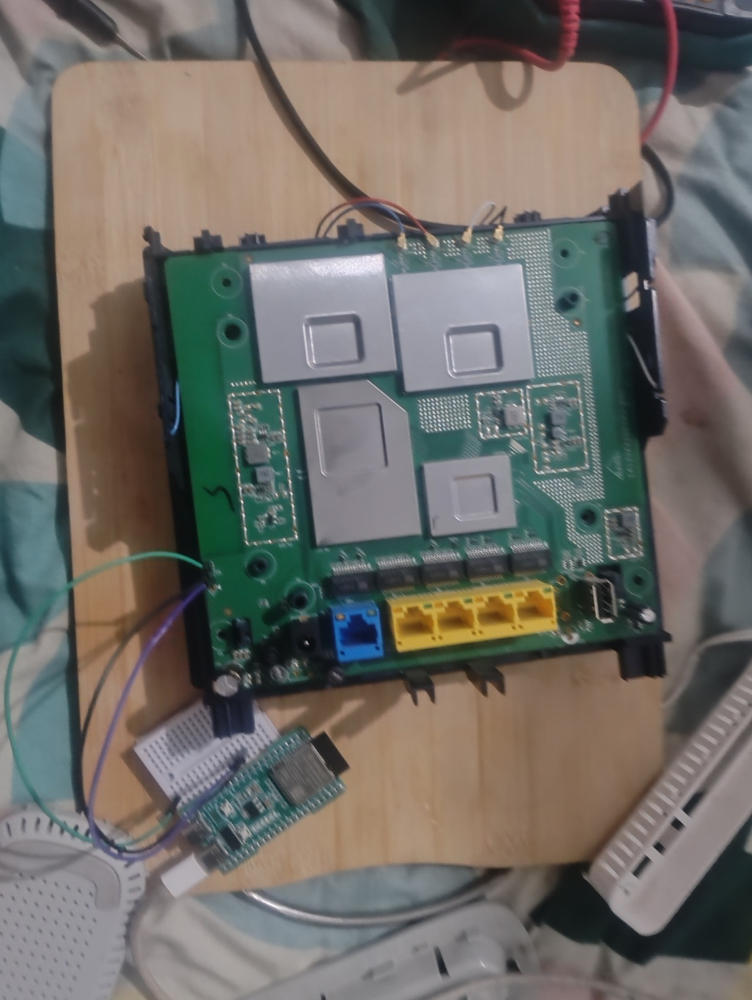

# OpenWrt on the Jio AirFiber indoor router (JIDU6101)

How one secure-boot-locked Jio AirFiber indoor unit was opened up over UART, backed up, and flashed with OpenWrt 25.12.5. Done 11 Oct 2026.

**Result:** OpenWrt boots from flash on its own, LuCI web UI works, Wi-Fi 6 runs WPA2/WPA3 mixed, and the stock flash is backed up.

## The device
| | |
|---|---|
| Product | Jio AirFiber indoor router, model **JIDU6101** (internal code RARHGLK00103, per OpenWrt forum) |
| Maker | Arcadyan (ODM) |
| SoC | MediaTek MT7986AV (Filogic 830), 4x Cortex-A53 @ 2 GHz |
| RAM | 512 MB DDR4 |
| Flash | 256 MB Winbond W25N02KV SPI-NAND (NMBM) |
| Wi-Fi | MT7976 (2.4 + 5 GHz, Wi-Fi 6, 4x4) |
| Switch | MT7531 |
| Ports | 1x 2.5GbE WAN (blue), 4x 1GbE LAN, USB, 12 V / 2.9 A barrel jack |
| Stock firmware seen | OpenWrt-based, Linux 5.4.225 built 28 May 2024, signed FIT image, dm-verity |
| Stock bootloader seen | BL2 v2.8 built **22 Aug 2023**, U-Boot 2023.04 |

This unit's BL2 was already the August 2023 build, so the BL2 downgrade step in other guides was **not needed**.

## What this needs you to know first
- The indoor unit is only a router. The 5G modem is in the outdoor unit, tied to Jio's provisioning. This work does **not** free the 5G link. Put the box behind another internet source (here: its WAN port into an existing router).
- Flashing is risky. Never write the **FIP** (mtd3) or **Factory** (mtd2) partitions. See [docs/03-gotchas.md](docs/03-gotchas.md).

## Docs
1. [Hardware and UART](docs/01-hardware-and-uart.md): where the serial header is, pins, how an ESP32-S3 was used as the USB-serial adapter
2. [Procedure](docs/02-procedure.md): every step in order, with commands
3. [Gotchas](docs/03-gotchas.md): what went wrong and the fixes
4. [Airtel AirFiber research](docs/04-airtel-aap4221zy-research.md): notes on the other router, not flashed
5. [Results: Wi-Fi channel tuning](docs/05-results.md): before/after speed from moving off a crowded channel
6. [Doom in the browser](docs/06-doom-in-the-browser.md): Doom running on the router, streamed to a browser tab

## Tools
- [`tools/uartbridge/uartbridge.ino`](tools/uartbridge/uartbridge.ino): ESP32-S3 USB to UART bridge
- [`tools/tftp_server.py`](tools/tftp_server.py): small read-only TFTP server
- [`tools/bootcmd-guard`](tools/bootcmd-guard): OpenWrt init script that restores the U-Boot boot command
- [`tools/backup.sh`](tools/backup.sh): dumps all MTD partitions over SSH
- [`tools/doom-web/`](tools/doom-web/): browser Doom for the router (build, play, self-check)

## Not in this repo (on purpose)
Flash dumps (they hold factory MACs and manufacturing data), serial numbers, MAC addresses, sticker passwords and Wi-Fi passwords.

## Credits
The boot method comes from [Tupu4545's JIDU6101 guide](https://gist.github.com/Tupu4545/d7bfee3ece7f9b50041c44525d229fcd) and the OpenWrt support work in [PR 22201](https://github.com/openwrt/openwrt/pull/22201) and [PR 25095](https://github.com/openwrt/openwrt/pull/25095). This repo records one unit's run, including a few differences (see gotchas).

Use at your own risk. This is an ISP-supplied device; check your terms.
